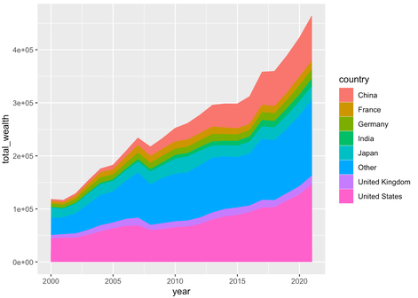

### Comparison of intertidal vs. subtidal habitats

Goal: Build a figure showing the number of heatwave-related publications over time (\~30 years), distinguishing between atmospheric vs. marine heatwaves for individual intertidal and subtidal habitats.

#### Tasks:

1.  Stacked bar graph for these to show total HW in one year and dived bar between the MHW and AHW

2.  Pie graphs: ALL MHW studies distribute over different habitats, all AHW distribution over different habitats

3.  Feedback from Pedro:

    Also, maybe you can add some rough data for frequency of works evaluating impacts of MHWs and AHWs but focused on terrestrial(note from tiff: change this to subtidal). I'm imagining the first plot (publication over time) with this style (see below), including stressor type and environment and using cumulative frequency. Do you think it would be possible to obtain data (at least rough numbers) on the frequency of terrestrial and marine publications?

    

Full Inter- and Sub-tidal Search String:

TS=( intertidal\* OR "rocky intertidal" OR "rocky shore" OR "rock shore" OR "wave-exposed shore" OR "mud flat" OR mudflat OR mud-flat\* OR "tidal flat" OR sandflat OR "sand flat" OR "coastal lagoon" OR "tidal creek" OR "salt marsh" OR saltmarsh\* OR marsh OR mangrove OR "mangrove forest" OR seagrass\* OR "sea grass" OR "seagrass meadow" OR "seagrass bed" OR "oyster reef" OR "oyster bed" OR "shellfish reef" OR "shellfish bed" OR "bivalve reef" OR "bivalve bed" OR "reef-forming bivalve" OR "biogenic reef" OR "mussel reef" OR "mussel bed" OR "living shoreline" OR subtidal OR sublittoral OR "shallow subtidal" OR "nearshore" OR "shallow water habitat" OR "rocky reef" OR "temperate reef" OR "coral reef" OR "coral bleaching" OR "reef-building coral" OR "kelp forest" OR "kelp bed" OR "kelp canopy" OR "kelp ecosystem" OR "macroalgal bed" OR "macroalgal forest" OR "canopy-forming macroalga" OR "fucoid") AND TS=( "marine heatwave" OR "ocean heatwave" OR "marine heat wave" OR "ocean heat wave" OR MHW OR "extreme temp\*" OR "extreme heat" OR "heat wave" OR heatwave OR "AHW" ) AND PY=(1995-2025)

Methods for search and analysis can be found in this google doc: <https://docs.google.com/document/d/19mXw0qHs-502BoXTs7imVbd8vulth_enSDzC0_aGaF8/edit?usp=sharing>

```{r}
  #| label: load-packages
  #| include: false
  #| message: false
  
  library(dplyr)
  library(readxl)
  library(readr)
  library(tidyverse)
  library(here)
  library(ggplot2)
  library(RColorBrewer)
```

```{r}
#| label: load-and-clean-data
#| message: false
#| include: false

inclusion_xl <- read_excel(here::here("data", "processed", "inclusion.xlsx"))
heatwave_type_xl <- read_excel(here::here("data", "processed", "heatwave_type.xlsx"))
habitat_xl <- read_excel(here::here("data", "processed", "habitat.xlsx"))
notes_habitat_xl <- read_excel(here::here("data", "processed", "notes_habitat.xlsx"))
references_xl <- read_excel(here::here("data", "processed", "references_export.xlsx"))

#clean inclusion excel sheet to remove unnecessary columns and make more R friendly
head(inclusion_xl)
inclusion_xl_clean <- inclusion_xl %>% 
  select(-`Time of Screening`, -Question, -`List of Reviewers`) %>% 
  rename(id = `ActiveScreener Id`, title = Title, author = Authors, inclusion = Answers) %>% 
  mutate(inclusion = str_remove_all(inclusion, '"')) %>% 
  mutate(inclusion = str_to_lower(inclusion))
head(inclusion_xl_clean)

#clean heatwave type excel sheet to remove unnecessary columns and make more R friendly. remove extra heatwave options included, only include first chosen heatwave type based on screening options.
head(heatwave_type_xl)
heatwave_type_xl_clean <- heatwave_type_xl %>% 
  select(-`Time of Screening`, -Question, -`List of Reviewers`) %>% 
  rename(id = `ActiveScreener Id`, title = Title, author = Authors, heatwave_type = Answers) %>% 
  mutate(heatwave_type = str_remove_all(heatwave_type, '"')) %>% 
  mutate(heatwave_type = str_to_lower(heatwave_type)) %>% 
  mutate(heatwave_type = str_trim(str_remove(heatwave_type, ",.*")))
head(heatwave_type_xl_clean)

#clean habiat excel sheet, leave multiple habitats in single row for now. once the id's are joined and duplicates are removed, then make multiple observations for each habitat.
head(habitat_xl)
habitat_xl_clean <- habitat_xl %>% 
  select(-`Time of Screening`, -Question, -`List of Reviewers`) %>% 
  rename(id = `ActiveScreener Id`, title = Title, author = Authors, habitat = Answers) %>% 
  mutate(habitat = str_remove_all(habitat, '"'))
head(habitat_xl_clean)

#clean notes sheet
head(notes_habitat_xl)
notes_xl_clean <- notes_habitat_xl %>% 
  select(-`Time of Screening`, -Question, -`List of Reviewers`) %>% 
  rename(id = `ActiveScreener Id`, title = Title, author = Authors, notes = Answers) %>% 
  mutate(notes = str_remove_all(notes, '"')) 
head(notes_xl_clean)

#clean references for relevant information
head(references_xl)
names(references_xl)
references_xl_clean <- references_xl %>% 
  select(-Abstract, -Citation, -Journal, -Level, -`Reference Status`) %>% 
  rename(id = `ActiveScreener Id`, title = Title, author = Author, year = Year) %>% 
  mutate(id = as.character(id))
head(references_xl_clean)


# join tables
data <- list(
  references_xl_clean,
  select(inclusion_xl_clean, id, inclusion),
  select(heatwave_type_xl_clean, id, heatwave_type),
  select(habitat_xl_clean, id, habitat),
  select(notes_xl_clean, id, notes)
) %>% 
  reduce(full_join, by = "id")

######### NEXT STEPS: identify and delete duplicates, create habitat (intertidal/subtidal) category, separate multiple habitats, delete NAs ############

#delete NAs/excludes
data <- data %>% 
  filter(!is.na(inclusion), inclusion == "include")

#separate multiple habitats to create individual rows (observations) for each habitat. this results in 1 paper accounting for multiple observations of different habitats. 
data <- data %>% 
  separate_longer_delim(habitat, delim = ",") %>% 
  mutate(habitat = str_trim(habitat)) %>% 
  filter(!is.na(habitat), habitat != "")

#create tidal variable
intertidal <- c("Rocky shore", "Tidal flat", "Oyster and mussel reef",
                "Other intertidal", "Mangrove", "Salt marsh")

data <- data %>%
  mutate(habitat_zone = if_else(habitat %in% intertidal, "intertidal", "subtidal"))

count(data, habitat, habitat_zone)

#create new id variable since we now have duplicate id's from web of science with having multiple papers represent 1 count for a single habitat observation
data <- data %>% 
  rename(wos_id = id)

data <- data %>% 
  mutate(id = row_number(), .before = wos_id)

glimpse(data) 

data %>% 
  write_csv(here::here("data", "processed", "data.csv"))
```
